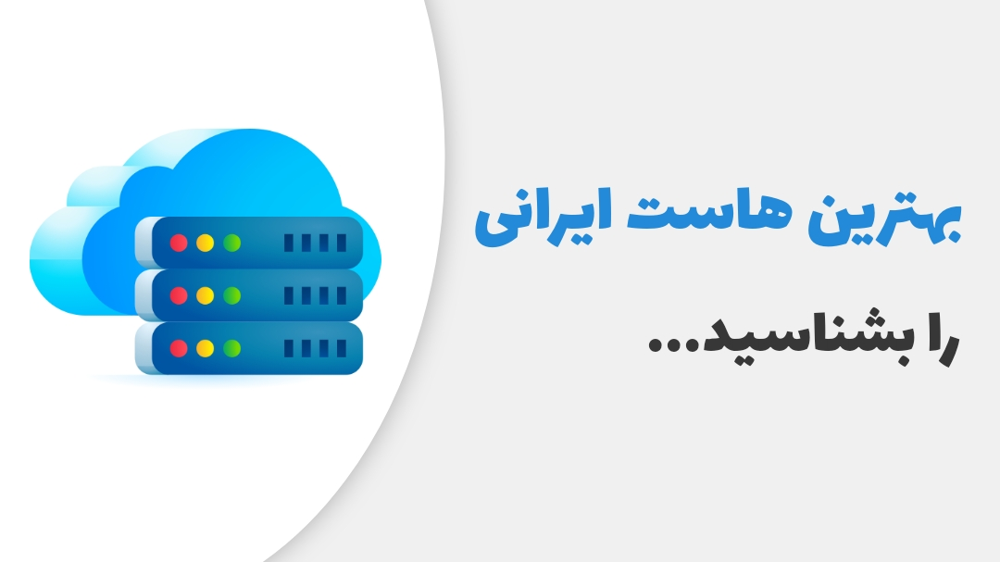
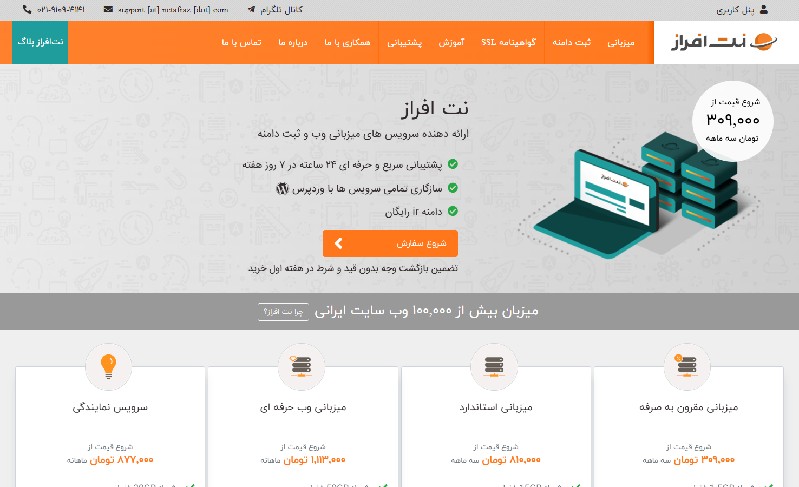
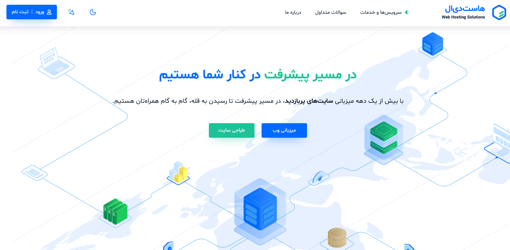
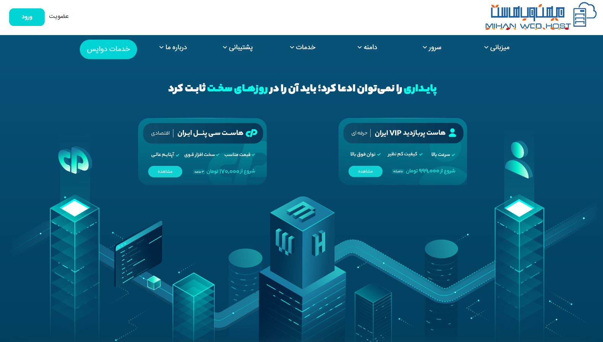
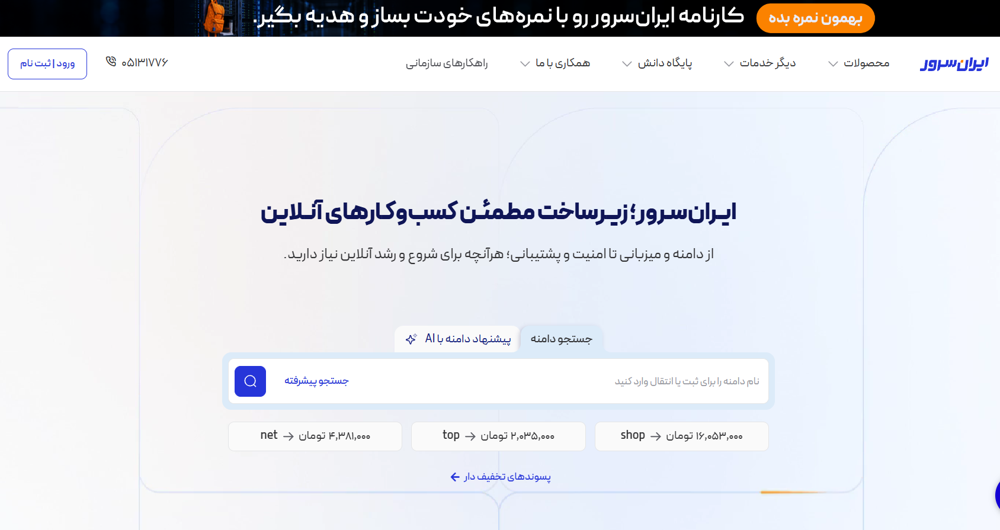
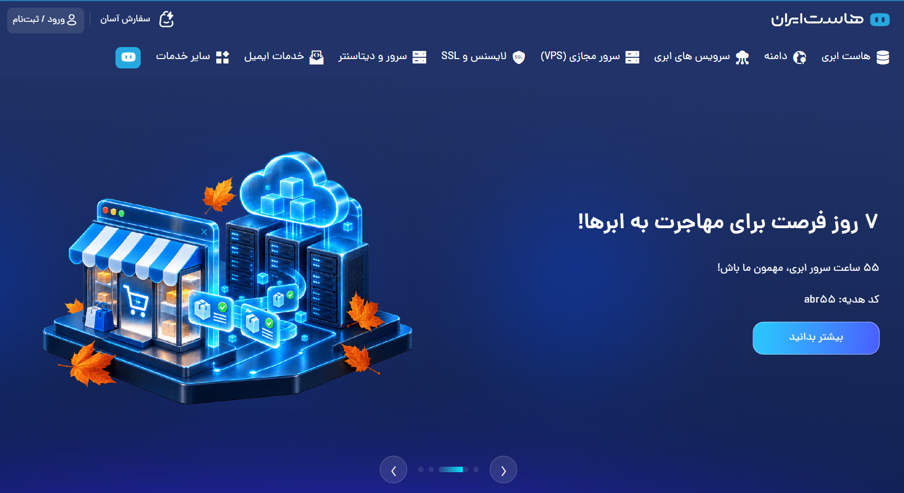
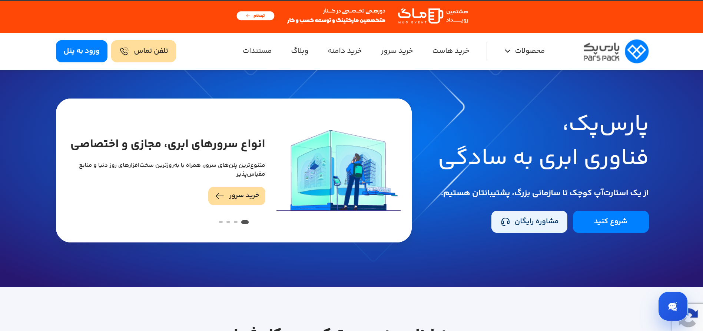

# بهترین هاست ایرانی (7 تا از بهترین شرکت های هاستینگ)

> 🔴 این مقاله در تاریخ <strong>1405/08/21</strong> بروزرسانی شده است.

راستشو بخواین، اصلا قرار نبود چنین مقاله‌ای منتشر کنیم!

ولی داستان از اونجایی شروع شد که متوجه شدیم حجم زیادی از سایت‌ها که اصلا حوزه کاریشون یه چیز دیگست و صرفا برای کسب درآمد افیلیت یا در ازای دریافت پول از شرکت‌های هاستینگ، اومدن یه مقاله در مورد معرفی بهترین شرکت‌های هاستینگ ایرانی منتشر کردن!

خوب این سایت‌ها به واسطه اعتبار دامنه و سئوی قوی، جایگاه گرفتن و زمانیکه کاربر عبارت *بهترین هاست* رو سرچ میکنه، متاسفانه این سایت‌ها بهشون نمایش داده میشه.

دیده میشه تو خیلی از همین سایت‌ها، طرف اومده شرکت هاستینگی که ناشناخته هستش و یا شرکتی که بیشترین نارضایتی از سمت کاربران رو داره، در رتبه ۱ یا ۲ بهترین هاست ایران قرار داده. این کار عملا باعث گمراهی کاربر میشه...

> خلاصه اینکه پیشنهاد می‌کنیم اصلا گول نخورین! حتی همین مقاله خودمون رو هم چندین بار بالا پایین کنید و تحقیق کنید و بعد با خیال راحت نسبت به خرید هاست اقدام کنید.

## بهترین هاست ایرانی کدومه؟

طبیعتا نیاز نیست توضیح بدیم که کیفیت خدمات و سرویس‌های میزبانی هاستینگ‌های خارجی با شرکت‌های ارائه‌دهنده هاست در ایران، زمین تا آسمون فرق داره!

در ایران هم کلی شرکت هاستینگ قدیمی و نوپا داریم که خوب هر کدومشون مزایا و معایب خاص خودشون رو دارن. مثلا اگه عبارت <strong>خرید هاست</strong> رو سرچ کرده باشین، میبینید که کلی شرکت در نتایج گوگل نمایش داده میشن.

اما سوال اصلی اینجاست! واقعا کدوم از این هاستینگ‌ها خدمات و سرویس‌های بهتری ارائه میده؟ آیا میشه به صورت رندوم و عشقی یکی از همین شرکت‌ها رو برای خرید هاست انتخاب کرد؟😁

پاسخ خیر است! چرا؟

چون هاست زیربنا و زیرساخت سایت شما رو تشکیل میده. اگه این زیربنا مستحکم و پایدار نباشه، با یه پس لرزه کوچیک از پا درمیاد و همه چیز خراب میشه. پس اگه تو انتخاب هاست دقت به خرج ندین، قطعی‌های مکرر، نفوذ و هک و... در انتظار سایتتون هستن😬

## لیست بهترین شرکت‌های ارائه‌دهنده هاست در ایران

خوب رسیدیم به اصلی‌ترین بخش مقاله. لازم به ذکر هستش که بخش بزرگی از این مقاله براساس تحربیات 8 ساله تیم فنی کلودیاب از کار با هاستینگ‌های مختلف، و بخش دیگر اون از طریق بررسی نظرات کاربران و مشتریان هاستینگ‌های مختلف در وب فارسی، نگارش و منتشر شده!

براین اساس، در پایین لیستی از بهترین شرکت‌های ارائه‌دهنده هاست ایرانی رو به ترتیب کیفیت خدمات و محبوبیت، معرفی می‌کنیم:

| سابقه فعالیت | شرکت هاستینگ |
|---|---|
| 18 سال | [نت افراز](#نت-افراز) |
| 18 سال | [هاست دی ال](#هاست-دی-ال) |
| 15 سال | [میهن وب هاست](#میهن-وب-هاست) |
| 5 سال | [لیمو هاست](#لیمو-هاست) |
| 24 سال | [ایران سرور](#ایران-سرور) |
| 24 سال | [هاست ایران](#هاست-ایران) |
| 17 سال | [پارس پک](#پارس-پک) |

## نت افراز
نت افراز جزو قدیمی‌ترین و بهترین شرکت‌های هاستینگ در ایران هستش که میزبان بیش از 100.000 وب‌سایت ایرانیه. ما خودمون در تیم کلودیاب تقریبا 7 سالی میشه که داریم از نت افراز استفاده می‌کنیم و در این سالها میزبانی پروژه‌های زیادی رو به Netafraz واگذار کردیم و خدارو شکر تا به امروز با مشکل خاصی مواجه نشدیم.

بررسی نظرات کاربران در وب فارسی هم نشون میده که انتخاب ما اشتباه نبوده. چرا که عمده کاربران از خدمات و محصولات این شرکت رضایت دارن.

### مزایای نت افراز:
- پشتیبانی مناسب
- سرورهای قدرتمند
- مانیتورینگ ۲۴ ساعته سرورها
- آپتایم بالای ۹۹٪ سرویس‌ها
- امنیت بسیار بالای سرویس‌ها
- بکاپ‌گیری خودکار هفتگی و روزانه
- پشتیبانی کامل سرویس‌ها از وردپرس
- امکان انتقال رایگان سایت به نت افراز
- قیمت‌گذاری منطقی و منصفانه سرویس‌ها
- تضمین بازگشت وجه یک هفته‌ای سرویس هاست

> 🎁 کد تخفیف نت افراز 12% ویژه خرید انواع هاست: <strong>UC108PYF</strong>

-----------------------------------------

## هاست دی ال
ممکنه اسم هاست دی ال رو اصلا نشنیده باشین! چرا که این هاستینگ در سکوت کامل و بدون هیچ گونه تبلیغات، تقریبا دو دهه هستش که در حوزه ارائه خدمات میزبانی وب فعالیت می‌کنه.

ولی جالبه بدونید که هاست دی ال میزبان بزرگ‌ترین و پرترافیک‌ترین وب‌سایت‌های ایرانیه! (مثل سافت ۹۸ و...). به گفته خودشون، میزان بازدیدهای صورت گرفته از سرورهای هاست دی ال بالغ بر ۱۰ الی ۲۰ میلیون در روز هستش که نشون دهنده گستردگی خدمات HostDL داره!

همچنین بد نیست بدونید که برخلاف سایر هاستینگ‌ها که پروسه خرید و تحویل هاست به صورت اتومات انجام میشه، هاست دی ال مشتریانش رو به صورت گزینشی انتخاب میکنه و تمام پروسه خرید و تحویل سرویس به صورت دستی و با تایید تیم HostDL انجام میشه!

> نت افراز و هاست دی ال جزو پیشنهادات ما هستن که میتونیم به عنوان بهترین هاست ایرانی بهتون معرفی کنم. اگر سایتتون نوپا یا متوسط هستش، میتونید از <strong>نت افراز</strong> استفاده کنید. اگر هم که سایتتون متوسط یا خیلی بزرگه، پیشنهاد می‌کنیم از <strong>هاست دی ال</strong> استفاده کنید😉

-----------------------------------------

## میهن وب هاست
اولین چیزی که حین باز کردن سایت میهن وب هاست باهاش مواجه میشین، شعارشون هستش که در ابتدای صفحه بولد شده؛

<strong>پایداری</strong> را نمی‌توان ادعا کرد؛ باید آن را در <strong>روزهای سخت</strong> ثابت کرد

میهن وب هاست هم جزو قدیمی‌های این حوزه هستش که تو این سالها تونسته با ارائه سرویس‌های باکیفیت و قیمت مناسب، مشتریان زیادی جذب کنه و امروز ما بتونیم اون رو به عنوان یکی از بهترین هاستینگ های ایرانی معرفی کنیم!

جالبه بدونید با اینکه قیمت‌های میهن وب هاست خیلی مناسبه، ولی باعث نشده روی کیفیت و مشخصات پلن هاست تاثیرگذار باشه. مثلا ارزون‌ترین پلن هاست شون که در لوکیشن ایرانه، قیمتش برای سه ماه ۱۷۰,۰۰۰ تومنه با مشخصات پایین:

- فضا ۲۰۰ مگابایت
- پهنای باند نامحدود
- رم ۲ گیگابایت
- پردازنده ۴ هسته
- وب‌سرور لایت اسپید
- پارک دامین نامحدود
- و...

نکته جالب‌تر اینکه طبق گفته خودشان، میهن وب هاست تکنولوژی Geo DNS و Geo Routing رو به صورت صد درصد رایگان در سطح شبکه برای تمامی پلن‌های هاست ایران خودش پیاده‌سازی کرده.

با این قابلیت، همواره نسخه به‌روز و کش شده از سایتتون حتی با محدود شدن اینترنت بین الملل، در دسترس خزنده‌های گوگل قرار می‌گیره تا سئوی سایتتون آسیب نبینه!

جالبه بدونید به دلیل قطعی اینترنت که در سال ۱۴۰۴ و ۱۴۰۵ اتفاق افتاد، اکثر شرکت‌های هاستینگ بابت اجرا و پیاده‌سازی قابلیت GeoDNS میلیون‌ها تومان از کاربران دریافت می‌کردن! ولی ظاهرا میهن وب هاست این قابلیت جذاب و کاربردی رو به صورت رایگان ارائه میده🙂

### مزایای میهن وب هاست:
- پشتیبانی مناسب
- امنیت مناسب
- بکارگیری حافظه NVMe
- بکاپ‌گیری منظم روزانه و هفتگی
- بهره‌برداری از سیستم LSCache
- انتقال رایگان سایت از سایر شرکت‌ها
- ارائه رایگان افزونه کش WP Rocket
- ارائه خدمات Geo DNS و Geo Routing به صورت رایگان
- اتصال بی وقفه با شبکه‌ای قدرتمند از چندین اپراتور
- گارانتی بازگشت وجه ۷ روزه در سرویس‌های سالانه

> 🎁 کد تخفیف میهن وب هاست 9% ویژه خرید انواع هاست و سرور: <strong>mwh-f102b</strong>
-----------------------------------------

## لیمو هاست
لیمو هاست جزو هاستینگ‌های نوپا محسوب میشه، ولی جالبه بدونید که مدیران آن جزو قدیمی‌های حوزه هاستینگ هستن!

لیمو هاست تونست با ارائه سرویس با کیفیت تخصصی هاست وردپرس تو همین مدت کم، به محبوبیت بسیار زیادی دست پیدا کنه. به نحوی که تا به امروز بیش از 70.000 وبسایت از خدمات این هاستینگ استفاده می‌کنن.

ایده راه‌اندازی لیمو هاست به نقل از خودشان؛

> لیمو هاست ایده‌ای بود که در پاسخ به یک خلأ واقعی متولد شد؛ ما طراحان لیمو هاست از قدیمی‌های هاستینگ ایران هستیم که از نزدیک شاهد دردسرهای زیرساختی و ضعف کیفیت هاست ایرانی بوده‌ایم. درست مثل شما، ما هم از دل دغدغه‌های یک سازمان کوچک، هدف بزرگی را دنبال کردیم و امروز می‌توانیم ادعا کنیم به این هدف نزدیک شده‌ایم؛ ساخت یک میزبانی امن و پایدار.

### مزایای لیمو هاست:
- پشتیبانی مناسب
- ترافیک نامحدود سرویس‌ها
- امنیت بالای سرویس‌ها
- تکنولوژی کش بهینه شده
- ارائه سرویس‌های متنوع
- منابع نیمه اختصاصی در هاست وردپرس
- بکاپ‌گیری منظم و خودکار از سرویس‌ها
- استفاده از سخت افزار قوی و بروز
- استفاده از حافظه پرسرعت NVMe
- استفاده از لایسنس اورجینال لایت اسپید
- استفاده از سی پی یو AMD Ryzen 9 7950X3D در سرویس هاست وردپرس

-------------------------------------------

## ایران سرور
به جرأت میشه گفت ایران سرور یکی از قدیمی‌ترین و معتبرترین هاستینگ‌های ایرانیه. ایران سرور جزو محدود شرکت‌هایی هستش که لیست محصولاتش به لحاظ تنوع واقعا کامله! به نحوی که کسب و کارهای کوچک، متوسط و بزرگ میتونن از خدماتش استفاده کنن.

همچنین پلن‌های متنوع هاست در ایران سرور باعث شده دستتون برای خرید هاست کاملا باز باشه! ایران سرور با معماری امنیتی چند لایه و سیستم‌های بکاپ‌گیری هوشمند، از داده‌های سایتتون در برابر هرگونه تهدید محافظت میکنه. پس خیالتون راحت😉

### مزایای ایران سرور:
- پشتیبانی ۲۴ ساعته
- تنوع بالای خدمات
- بکاپ‌گیری خودکار
- امنیت بالای سرویس‌ها
- آپتایم 99/9% سرویس هاست
- بکارگیری لایت اسپید اورجینال
- سرورهای کم تراکم برای سرعت بیشتر
- استفاده از سخت‌افزار قوی و بروز
- ارائه SSL رایگان همراه هاست
- ایمن سازی اطلاعات با تکنولوژی Raid در هاست وردپرس
- بکارگیری هارد NVMe در هاست وردپرس و ووکامرس
- گارانتی بازگشت وجه ۱۴ روزه سرویس هاست

----------------------------------------

## هاست ایران
هاست ایران با بیش از دو دهه سابقه فعالیت در حوزه میزبانی وب، بدون شک یکی از بهترین هاستینگ های ایرانیه.

این شرکت هم مثل ایران سرور، طیف گسترده‌ای از خدمات و محصولات مثل: هاست لینوکس، هاست وردپرس، هاست ووکامرس، هاست ویندوز، سرور ابری ایران، سرور ابری خارج، سرور مجازی، خدمات دیتاسنتر، خدمات ایمیل و... رو ارائه میکنه و تا به امروز بیش از 320.000 کسب و کار از محصولات این شرکت استفاده می‌کنن.

هاست وردپرس شرکت هاست ایران روی جدیدترین و سخت افزارها و سرورهای قدرتمند پیاده سازی شده تا بالاترین سطح پایداری و سرعت برای سایت‌های وردپرسی فراهم کنه. همچنین هاست ایران با بکاپ‌گیری دوره‌ای منظم، امنیت اطلاعات سایتتون رو تضمین می‌کنه!

### مزایای هاست ایران:
- بکاپ‌گیری خودکار
- استفاده از زیرساخت ابری
- بکارگیری سخت افزار بروز
- ایزوله بودن کاربران در هاست اشتراکی
- استفاده از آنتی ویروس قوی
- ترافیک نامحدود در اکثر پلن‌های هاست
- دیتابیس نامحدود در هاست وردپرس
- گارانتی بازگشت وجه ۷ روزه سرویس هاست
- میزبانی بر پایه کلاستر نسل ۱۱ در هاست وردپرس
- استفاده از وب سرور لایت اسپید در هاست وردپرس
- محافظت پیشرفته در برابر حملات DDoS

> 🎁 کد تخفیف هاست ایران 15% ویژه خرید انواع هاست و سرور: <strong>netifa</strong>

------------------------------------------

## پارس پک
پارس پک اولین ارائه دهنده خدمات ابری در ایران هستش که در فروردین سال ۱۳۸۸ به طور رسمی فعالیتش رو شروع کرده و اکنون با بیش از ۲۰۰.۰۰۰ مشتری، به عنوان یکی از بهترین هاستینگ های ایرانی شناخته میشه.

از حق نگذریم، پارس پک هم واقعا لیست محصولاتش کامله و درواقع فرقی نمیکنه کسب و کارتون کوچیک باشه یا بزرگ، در هر حالتی پارس پک میزبان شماست😉

یکی از ویژگی‌های جذاب پارس پک اینه که شما خودتون میتونید به صورت دستی منابع هاست‌تون (رم، فضا، پردازنده) رو تنظیم کنید و از انتخاب کنترل پنل گرفته تا لوکیشن و دوره پرداخت، همگی دست خودتونه!

### مزایای پارس پک:
- پشتیبانی مناسب
- پنل مدیریتی اختصاصی
- مقیاس‌پذیری آنی
- پایداری دائمی و 99.9%
- پهنای باند نامحدود
- تعداد پایگاه داده نامحدود
- تعداد اکانت ایمیل نامحدود
- تعداد ساب دامنه نامحدود
- تعداد اکانت FTP نامحدود
- تعداد پارک دامنه نامحدود
- بکارگیری وب سرور لایت اسپید
- استفاده از Memcached
- امکان نصب سریع وردپرس
- امکان تغییر لوکیشن هاست
- بکاپ‌گیری خودکار روزانه از دیتابیس
- بکاپ‌گیری خودکار هفتگی از کل سایت
- و...

------------------------------

امیدواریم از این مقاله نهایت استفاده رو برده باشین و براتون مفید بوده باشه❤️ هدف ما آگاه کردن شما و انتقال تجربه است و تصمیم‌گیری نهایی برای خرید هاست و انتخاب شرکت هاستینگ با خود شماست😉

در پایان هم پیشنهاد می‌کنیم اگر تجربه استفاده از محصولات و خدمات شرکت‌های هاستینگ ایرانی رو دارین، از طریق تب Discussions در بالای ریپازیتوری، تجربیات ارزشمندتون رو با ما و سایر کاربران به اشتراک بزارین🤝
